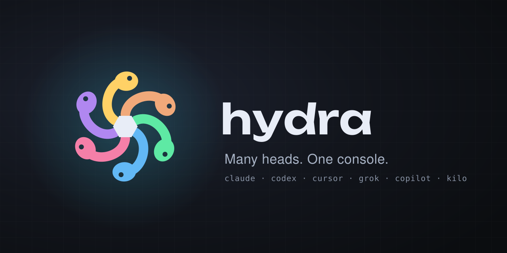

# Hydra brand

> **Many heads. One console.**



Hydra drives six coding agents from one browser. The identity says exactly
that: six serpent heads rising from a single body. The body is the console;
each head is an agent. The visual brand book is [`guidelines.html`](guidelines.html)
(open it in a browser). This file is the working reference.

Every asset here is **generated**. Change the geometry or palette in
[`build.mjs`](build.mjs) and run

```bash
node brand/build.mjs
```

It rewrites `brand/logo/`, `brand/icons/`, the web app's icon files and
`web/components/brand/geometry.ts`, so the favicon, the sidebar mark and these
files can never drift apart. Never hand-edit an output.

---

## The mark

Six necks leave a hexagonal core at 60° intervals and curl clockwise. Each
ends in an elongated head aimed along its neck, with an eye cut *through* the
mark (a hole, not a dot, so it sits on any background).

- **One head per provider**, in `PROVIDER_IDS` order, clockwise from Claude's
  head at 2 o'clock: Claude, Codex, Cursor, Grok, Copilot, Kilo Code. A seventh
  provider needs a new mark; `web/test/components/brand/geometry.test.ts` fails
  until that happens.
- **The clockwise curl** is motion: work flowing out from the console. Never
  mirror the mark.
- **The fused core** is the point. The necks start inside the hexagon so the
  mark reads as one animal, not six things orbiting a dot.

### Variants

| File | Use |
|---|---|
| `logo/hydra-mark.svg` | **Primary.** Brand gradient on dark surfaces. |
| `logo/hydra-mark-daylight.svg` | Primary on light surfaces (darkened gradient). |
| `logo/hydra-mark-spectrum.svg` | Hero moments: one head per agent colour, Bone core. Only where agents are the subject. |
| `logo/hydra-mark-cyan.svg` | Single-colour on dark, when a gradient can't be reproduced. |
| `logo/hydra-mark-bone.svg` / `-ink.svg` | One-colour knock-out on dark / light. Print, embossing, monochrome contexts. |
| `logo/hydra-mark-small.svg` | **24 px and below.** No eyes, heavier necks, rounder heads. |

### Lockups

| File | Use |
|---|---|
| `logo/hydra-lockup-dark.svg` / `-daylight.svg` | Horizontal. Default lockup. |
| `logo/hydra-lockup-stacked-dark.svg` / `-daylight.svg` | Square-ish spaces: splash, about panels. |
| `logo/hydra-wordmark-bone.svg` / `-ink.svg` | Wordmark alone, when the mark already appears nearby. |
| `logo/hydra-banner.svg` (`icons/hydra-banner.png`) | README header and social preview, 1280×640. |

In the horizontal lockup the wordmark's x-height is centred on the core and the
gap between mark and word is one head length (12 units on the 64 grid).

### Clear space and size

- **Clear space:** one head length (≈ 3/16 of the mark's height) on every side.
  Nothing — text, edges, other marks — enters it.
- **Minimum size:** full mark 28 px; below that use the small cut, down to
  16 px. Horizontal lockup: 96 px wide.

### Don't

- Recolour individual heads outside the spectrum mapping (a head's colour *means* a provider).
- Rotate, mirror, stretch, outline or add drop shadows.
- Put the gradient mark on a busy photo or on mid-tone backgrounds; use the
  one-colour Bone or Ink cut instead.
- Re-set the wordmark in live text in logo contexts — use the outlined files.
- Use the full (eyed) mark under 28 px.

---

## The living mark

In the app the mark is also an instrument. `HydraMark` with `live` lights the
heads of providers that have a run in flight in their agent colour; idle heads
dim, and the whole body turns slowly (one revolution per 36 s). The sidebar's
mark is therefore a glance at the fleet. Both "reduce effects" and the OS
reduced-motion setting freeze the motion; the colours alone still carry the state.

Which runs are live comes from the server's run list — the mark renders it, never
derives it (see AGENTS.md → *The server owns run truth*).

---

## Colour

The brand palette **is** the app's theme palette; nothing here is new paint.
The brand formalises names and one gradient.

| Name | Hex | Theme token | Role |
|---|---|---|---|
| **Hydra Cyan** | `#38d9f0` | Midnight `--accent` | Primary brand colour; gradient start. |
| **Venom Violet** | `#b39bf8` | Midnight `--violet` | Gradient end. |
| **Abyss** | `#12151c` | Midnight `--surface-0` | Primary dark ground; app icon plate. |
| **Trench** | `#0b0d10` | Deep `--surface-0` | Deepest ground. |
| **Bone** | `#e8edf7` | Midnight `--fg` | Text and one-colour mark on dark. |
| **Ink** | `#0f1520` | Daylight `--fg` | Text and one-colour mark on light. |
| **Deep Cyan** | `#0d7287` | Daylight `--accent` | Gradient start on light. |
| **Deep Violet** | `#6b4bd6` | Daylight `--violet` | Gradient end on light. |

**Venom gradient:** Hydra Cyan → Venom Violet, at 135° (top-left to
bottom-right). Available in CSS as `--brand-from` / `--brand-to` (Tailwind:
`from-brand-from to-brand-to`); Daylight swaps in the deep stops. Use it on
the mark only — never as a text fill or a large background.

**Agent spectrum:** the six `--agent-*` tokens (Claude `#f0a97a`, Codex `#5ee9a4`,
Cursor `#62b8f5`, Grok `#f57fa8`, Copilot `#b087f0`, Kilo Code `#ffd166`). They
belong to the agents; the brand borrows them only in the spectrum mark.

---

## Typography

| Role | Typeface | Notes |
|---|---|---|
| **Display** | [Unbounded](https://fonts.google.com/specimen/Unbounded) 500–600 | Wordmark (SemiBold, −10 tracking, outlined), page titles, brand moments. Never body text or UI labels. CSS `--font-display`, Tailwind `font-display`. |
| **Text** | [Geist](https://vercel.com/font) 400–600 | All UI and reading text. The app's 16 px scale is built on it. |
| **Code** | [Geist Mono](https://vercel.com/font) | Terminal output, paths, ids, numbers that tick. |

Unbounded's wide, rounded geometry echoes the curve of the necks; Geist keeps
the console legible. Titles set in Unbounded use weight 500 and −0.015em
tracking. All three are SIL Open Font License; the web app loads them through
`next/font`, so nothing is vendored here.

---

## Voice

- **Tagline:** *Many heads. One console.*
- Lowercase **hydra** in the wordmark; **Hydra** in prose.
- Talk like the console does: concrete, calm, specific. Say what an agent is
  doing, not how exciting it is.

---

## Files

```
brand/
  build.mjs            generator (only dependency: sharp)
  source/wordmark.json outlined wordmark, Unbounded SemiBold
  guidelines.html      visual brand book
  logo/                SVG marks, lockups, wordmarks, app icon, banner
  icons/               PNG app icons 64–1024, apple-touch 180, maskable 512,
                       favicons 16/32/48, favicon.ico, banner.png
web/app/               favicon.ico, icon.svg (follows OS scheme), apple-icon.png, manifest.ts
web/public/brand/      PWA icons 192/512 and maskable 512
web/components/brand/  HydraMark, HydraWordmark, generated geometry.ts
```
