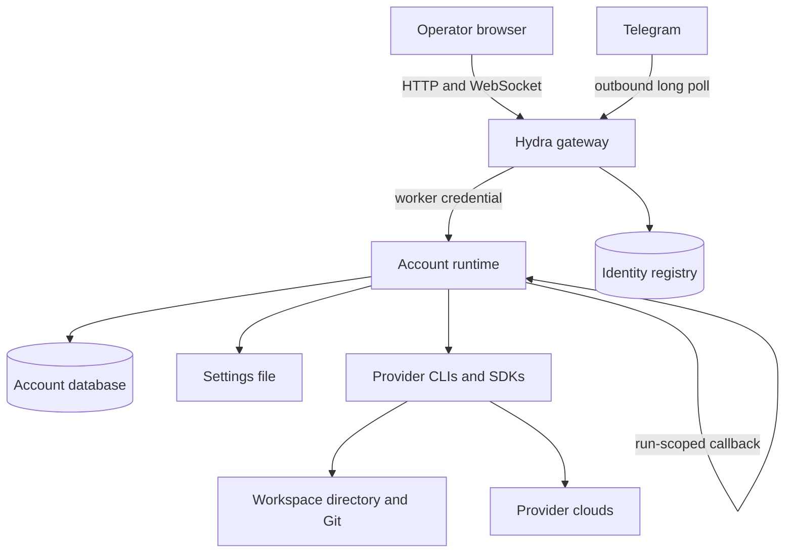

# Solution architecture

| | |
|---|---|
| Status | Baseline specification |
| Audience | Solution architect, developer |
| Depends on | [Domain model](../domain/domain-model.md), [Vision and scope](../product/vision-and-scope.md) |

## 1. System context



The operator's browser talks only to Hydra. Provider clouds are reached by the provider's own executable or SDK, using the operator's login or key. Telegram is reached by outbound HTTPS. Hydra does not accept a public webhook and does not require an inbound port.

**Decision ADR-01. One machine, no database server.** State is SQLite files on the host. The product shall not introduce a network database, a queue service, or a cache service. Coordination that looks like a queue is a table in the account database, in particular the supervised dispatch outbox.

**Decision ADR-02. The browser is a client.** The web application shall not open SQLite, shall not read the workspace from disk, and shall not hold a provider key. If a screen needs a fact, the server computed it or stored it.

## 2. Containers

| Container | Responsibility | Shall not |
|---|---|---|
| Web app | Render the console, hold the WebSocket, keep browser-local drafts and tour progress. | Derive run elapsed time, usage totals, or terminal state. Decide policy. |
| Gateway | Bind the public port, authenticate cookies, rate-limit auth and recovery, route an account to its runtime, host the single Telegram poller on the live console. | Contain workspaces, pipelines, or provider sessions of its own. |
| Account runtime | Own one account's library, runs, pipelines, settings, and child processes. | Serve a request that lacks the gateway credential. Accept an agent callback without the run credential. |
| Identity registry | Users, sessions, the bot, links, recovery codes, demo expiry. | Store workspaces or transcripts. |
| Account database | The domain model for that account. | Be opened by a second process as a second writer. The live console is the writer. |
| Provider adapter | Turn one provider's stream into normalised events. | Leak that provider's raw event shape past the adapter. |
| `agent-step` | The executable an agent is told to run to checkpoint, post status, and read its brief. | Offer a general database shell. |

The live console is one gateway plus the runtimes it supervises, started by `serve`, listening by default on `127.0.0.1:4000` for the API and WebSocket and on port 3000 for the web app.

**Decision ADR-03. Account runtimes are separate.** Each account has its own database file and its own settings file, and its application traffic is handled by a runtime that will not answer without the gateway credential. This is process-and-file isolation for records. It is not OS-user isolation. That limit is specified in [security and tenancy](security-and-tenancy.md).

## 3. Component placement

The repository is three packages. Shared code is the contract. The server is the policy and the persistence. The web package is the rendering.

```text
shared/          @hydra/shared
  contracts/     wire shapes and record shapes
  models/        catalogues, statuses, usage, drafts, execution plans
  policies/      pipeline transitions, station capability, provider failure
  utils/         formatting and parsing shared by both sides
server/
  api/           HTTP, WebSocket, access log
  config/        boot configuration and the settings field table
  contracts/     adapter, run, and process interfaces
  domain/        pure rules
  infrastructure/ processes, containment, locks, OS integration
  providers/     adapters, native stream decoders, registry, install, discovery
  repositories/  SQLite, migrations, retention
  services/      orchestration: runs, pipelines, programs, verification, telegram
web/
  app/           routes
  features/      one folder per product area
  components/    shared UI, layout, theme
  contexts/      socket, account, workspace, fleet
  api/           typed HTTP client
```

**Decision ADR-04. One public shared surface.** Consumers import from `@hydra/shared`. The package's entry lists every export. A type that crosses the wire or is stored as a record is defined once, in `shared`. The web package and the server shall not redefine it.

**Decision ADR-05. Providers stay behind the adapter.** Each provider implements the agent-adapter interface and yields only `assistant_text`, `tool_use`, `tool_result`, `status`, `result`, and `error`. Provider-specific JSON stops inside the adapter and its stream decoder. Adding a provider is one adapter, one registry row, one id in the provider list, and one chip colour. It is not a new event type and not a new screen architecture.

Placement rules for new code are normative in the [construction standards](../engineering/construction-standards.md).

## 4. Runtime behaviour that the structure exists to protect

**Decision ADR-06. The server owns run truth.** The server assigns the run id, emits the status heartbeat, records token usage, and decides the terminal state. The browser displays the latest snapshot. A client timer is not the elapsed clock. A client sum is not the usage total.

**Decision ADR-07. Stream, do not buffer.** As an adapter yields an event, the server persists what it must and forwards the event on the socket. A run that produces a long transcript shall be visible before it ends. Retention may later trim stored events. Trimming is not a reason to buffer the live socket.

**Decision ADR-08. Failures are events.** A crashed child, a stream the adapter cannot parse, or a provider error becomes an `error` event and a terminal run state. The socket stays up for the console. Child standard error goes to the server log. The browser receives it only as the tail of a fatal error, not as a second log console.

**Decision ADR-09. Settings are a field table.** The Agents screen renders the server's field table: type, group, label, options, danger, default. Adding a setting means adding a field. The browser shall not grow a private form for a knob the table does not list. Saved values override defaults and apply on the next run, without a restart. Open consoles receive `settings_updated`.

**Decision ADR-10. Git belongs to the operator.** No service in this architecture stashes, resets, checks out, or cleans the operator's work. The only commit Hydra performs for agent work is the checkpoint invoked through `agent-step`. A dirty tree refuses a saved work-item run before a child starts.

**Decision ADR-11. Library mutation is propose-then-apply.** Program authoring and prompt-pack import both have an inspectable pending artefact. The write into `program`, `suite`, and `prompt` happens in the apply step, in one transaction, or not at all.

**Decision ADR-12. Migrations are append-only.** Schema evolution is a new version inside the account database's migrate transaction, plus a row in `schema_migration`. Versions run when the database is opened. An applied version is never edited. Migrations are additive. Destructive rewriting of history is a new version that copies forward, and it is specified in the data design before it is written.

## 5. Request paths

### 5.1 A conversation turn

1. The browser sends a `run` message on the authenticated WebSocket, naming the provider, workspace, mode, and either free text or a work item id.
2. The runtime checks the session, the workspace, the model ceiling, the writer or consultation lock, and, for a saved work item, the Git preconditions.
3. On refusal the server sends `run_rejected` and starts no child.
4. On acceptance the server inserts the agent run, sends `run_started`, and starts the adapter.
5. Events stream as `event` messages. Heartbeats are `status` payloads with the server clock and the usage so far.
6. The terminal event is followed by `run_ended`.

Reconnect sends `hello` with the providers and the active run snapshots, including events still inside the retention window. `truncated` tells the client when the snapshot is not the full transcript.

### 5.2 A pipeline step

1. Play creates a pipeline run in `PLAYING` and selects the first ready station whose dependencies are satisfied and whose assignment resolves to an eligible provider.
2. The scheduler starts an agent run of role `execute` with the station's content, the station policy, and the callback credential.
3. The agent reads context and posts progress only through `agent-step`.
4. A terminal handoff (`done`, `continue`, `blocked`, `decompose`) requires a clean checkpoint when the tree has changes.
5. The scheduler applies the station rule and the pipeline policy, then either starts the next station, repeats the station, waits, or parks.
6. Pause, stop, and resume are operator commands on the pipeline run. They are not inferred from prose in the work item.

### 5.3 An agent callback

The child is told how to call `agent-step`. That executable calls the runtime over HTTP with the run-scoped credential. The operation is one of the verbs in the [service contracts](../interfaces/service-contracts.md). The runtime writes the domain change, appends an access-log event of type `db_access` for the operator's transcript, and returns a structured acceptance or refusal. A refusal includes a code the agent can correct, such as a missing checkpoint.

**Decision ADR-13. The callback is the only write path for an agent.** The prompt may tell the agent about the verbs. The security of the path is the run credential, the verb allow-list, and the fact that the credential does not authorise any other account or any other run.

## 6. Deployment view

| Deployment | Ports | State | Pipelines on start | Telegram |
|---|---|---|---|---|
| Live console (`serve`) | 3000 and 4000 | The real state directory | Resume those interrupted by restart inside 24 hours, per policy | Polls, if a token is saved |
| Development sandbox | 3100 and 4100 | A copy under the sandbox directory | Do not auto-resume | Do not poll |
| Watched dev server | Separate from live | Refuses the default live database | — | — |

**Decision ADR-14. The live console is not the development loop.** `serve` frees ports 3000 and 4000 and therefore kills whatever is bound there, including a busy console. Development shall use the sandbox, which copies the registry, account databases, and settings, then runs on the sandbox ports. The copy is of state, not of workspace directories. A sandbox agent can still edit a real project if an operator starts one. The specification requires the sandbox to make that obvious and to disable the two automatic side effects: pipeline resume and Telegram polling.

Default state layout, override variables, file modes, and backup sets are specified in the [data design](../data/data-design.md).

## 7. Cross-cutting mechanisms

| Mechanism | Specified behaviour |
|---|---|
| Elapsed time | Status heartbeat, default one second, server clock. |
| Allowed browser origins | Explicit list. The cookie is SameSite=Strict. |
| Provider discovery | `PATH`, then the Hydra-managed install location, then an explicit binary override. |
| Provider install location | Under `$XDG_DATA_HOME/hydra-cli/<provider>`, separate from the checkout's dependencies. Claude's SDK is a project dependency. |
| Model list | Refresh from the provider where supported. The bundled catalogue is the offline fallback. |
| Failure classification | Provider failures are classified so cooling and fallback can be decided without each adapter inventing a policy. |
| Resource containment | Memory, swap, and process limits where the host can apply them. Where it cannot, cancellation still applies and the limit is reported as absent. |
| Environment scrub | State-locating variables and the gateway secret are removed from child environments in every place a child is spawned. A new state-locating variable is added to every one of those places in the same change. |
| Instance lock | One writer for a given state directory. A second live console against the same files is a misdeployment, not a feature. |

## 8. Decision index

| Id | Decision |
|---|---|
| ADR-01 | SQLite on one machine. No separate database or queue service. |
| ADR-02 | The browser never touches state or secrets. |
| ADR-03 | One runtime and one database per account, behind a gateway credential. |
| ADR-04 | `@hydra/shared` is the only public protocol package. |
| ADR-05 | Provider shapes die inside the adapter. |
| ADR-06 | The server owns identity, clock, usage, and terminal state of a run. |
| ADR-07 | Events are streamed as they are yielded. |
| ADR-08 | Failures are events. |
| ADR-09 | Settings are a field table. |
| ADR-10 | The operator owns Git. Checkpoints are the only agent commits. |
| ADR-11 | Library changes are propose-then-apply. |
| ADR-12 | Migrations are versioned and immutable once applied. |
| ADR-13 | Agents write Hydra state only through the run-scoped callback. |
| ADR-14 | Development uses a copy of state and does not resume or poll. |

A new architectural choice that contradicts a row is an edit to this index in the same change as the code. A choice that only fills a gap gets the next ADR number.
