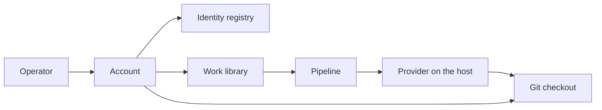

# Domain model

| | |
|---|---|
| Status | Baseline specification |
| Audience | Business analyst, solution architect, developer, database administrator |
| Depends on | [Vision and scope](../product/vision-and-scope.md) |

This is the language of the product. Requirements, screens, APIs, and tables use these words with these meanings. A synonym in a single screen is a defect.

## 1. Glossary

| Term | Meaning |
|---|---|
| Installation | One Hydra process family on one machine, with one identity registry. |
| Installation owner | The single account that owns the original application database and the installation settings file. |
| Account | A login. Owns a private application database and a private settings file. New accounts start empty. |
| Operator | The person using an account. The product has no separate "admin role" inside an account. |
| Workspace | A named binding to an existing host directory, plus standing instructions. |
| Program | An outcome the operator wants from a workspace. Contains suites. |
| Suite | A related batch of work inside a program. Contains work items. |
| Work item | One task, stored as a prompt: title, content, status, order, optional parent, optional external key. "Prompt" is the persistence name. Operator-facing language says work item. |
| Station | A work item as a step inside a pipeline run. The same work item can be a station in more than one pipeline. |
| Dependency | A directed link from a work item to another work item that must satisfy "done" first. No self-links. No cycles. |
| Gate | A named checkpoint on a program, pointing at one work item. |
| Pipeline | A saved execution setup: a name, an ordered set of suites (stages), and assignments. Not a copy of the library. |
| Stage | A suite's place in a pipeline. |
| Assignment | The provider and model a pipeline will use for a suite or, by override, for one station, plus the on-done and on-unfinished rules. |
| Pipeline run | One Play of a pipeline. Has a lifecycle separate from the pipeline definition. |
| Agent run | One invocation of one provider. Belongs to a workspace. May belong to a work item, a thread, a verification, an audit, or an author draft. |
| Role | Why an agent run exists: `execute`, `consult`, `handoff`, or `author`. |
| Ask | A consultation: role `consult`. Read-only by product intent. Does not require a clean tree. |
| Run (mode) | A writable invocation: role `execute`. May edit the workspace. |
| Thread | A named conversation in a workspace, made of one or more custom agent runs. |
| Provider | One of the six agents: `claude`, `codex`, `cursor`, `grok`, `copilot`, `kilocode`. |
| Model ceiling | The account policy that bounds which models may be selected. |
| Definition of done | The criteria that must hold before a scope counts as finished. |
| Criterion | One done check: prose, a command, or children-closed. |
| Evidence | A recorded result for a criterion, attributed to a source. |
| Verification | A stored pass over a suite or a work item that produces a verdict and per-item checks. |
| Completion audit | A read-only review of whether a station's claim of done holds. |
| Change capsule | The Git record of one writable run: repository, base, head, and the commits between them. |
| Checkpoint | The sanctioned commit of the current run's work, with a subject line, performed before a terminal handoff. |
| Handoff | A recorded transfer from one provider to another for the same station. The saved assignment does not change. |
| Program draft | A proposed program that is not in the library until applied. |
| Instruction proposal | A proposed replacement for a workspace instruction file, pending until applied or discarded. |
| Delivery contract | The supervised allowance for one requirement: criteria, policy, budget, phase, and desired state. |
| Work unit | A slice of a delivery contract, tied to a work item, covering criteria and targets. |
| Shadow mode | The supervisor records decisions and does not dispatch. |
| Status catalogue | The account's definitions of work-item status: labels plus the policy flags the scheduler trusts. |
| Remark | A note on a work item, from an operator, an agent, or the system. |
| Aside | A short operator message to a live agent (`/btw`). |

## 2. Context



The identity registry is installation-wide. The work library, pipelines, runs, and settings are per account. The Git checkout is a host directory. Accounts do not own it. The writer lock and the repository lock are what stop two writers from sharing it.

## 3. Aggregates

An aggregate is the consistency boundary. A transaction that changes an aggregate does not leave another aggregate half-updated. Cross-aggregate effects are events or later rows, not silent dual writes without a recorded reason.

### 3.1 Identity

Owned by the installation, not by an account database.

- **User**: id, username, password hash, salt, whether this user owns the original data, optional demo expiry.
- **Session**: hash of the token, user, expiry. The raw token exists only in the cookie.
- **Telegram bot**: at most one row. Token, bot id, username, update offset.
- **Telegram link**: at most one per user and at most one per Telegram user. Access is `notify` or `control`.
- **Recovery code** and **link code**: hashed, expiring, single-use in effect.
- **Telegram audit**: append-only for that user, capped.

Deleting a user deletes their sessions, link, codes, demo row, and audit. It does not delete another account's database as a side effect of a foreign key. Account-database removal is an explicit lifecycle action, specified for demo expiry and for any future account-deletion feature.

### 3.2 Workspace library

Owned by one account.

```text
Workspace
└── Program
    ├── Suite
    │   └── Work item (prompt)
    │       ├── children (work items with a parent)
    │       ├── dependencies
    │       ├── revisions
    │       ├── status events
    │       ├── remarks
    │       └── clarification exchanges
    └── Gates (each points at one work item)
```

A workspace also holds instruction text and instruction revisions, program drafts, and instruction proposals.

**Identity of a work item** inside the library is its numeric id. **Identity across an import** is the external key, unique among siblings. Titles are unique among siblings as well, case-insensitively, so an operator never sees two indistinguishable names. Those are different constraints and both hold.

### 3.3 Pipeline definition

A pipeline references suites. It does not embed them.

- Stages: suite plus sort order, unique suite per pipeline.
- Suite assignment: default provider, model, and fallback list for that suite in this pipeline.
- Station override: provider, model, fallbacks, `onDone`, `onUnfinished`, order. Present when this pipeline has something to say about that work item.

`onDone` is `continue`, `stop`, or `skip_rest`.

`onUnfinished` is `continue`, `skip`, or `wait`.

Automatic reassignment is a flag on the pipeline, default off.

Deleting a suite that a pipeline still stages is a library operation that must remove or refuse the stage. The specification requires referential integrity: a stage cannot point at a missing suite.

### 3.4 Runs

An **agent run** is the record of one provider invocation.

| Field group | Holds |
|---|---|
| Identity | Run id, workspace, optional work item, optional thread, role |
| Provider | Provider id, model, permission key, native session id when one exists |
| Lifecycle | `starting`, `running`, `done`, `interrupted`, `error`, plus stop reason |
| Usage | Input, output, cached input, tool calls, tool output bytes, peak memory. Null means unknown |
| Clock | Started at, ended at. Elapsed time shown in the browser is the server clock, not a client timer |
| Callback | Hash of the run-scoped credential and its expiry. The raw credential is not stored |

A **pipeline run** is one Play. At most one active run per pipeline. Active means `PLAYING`, `WAITING_HUMAN`, or `PAUSED`. Terminal means `COMPLETE`, `STOPPED`, or `INTERRUPTED`.

A **suite pipeline run** is the stage execution under a pipeline run. It carries the current station and the current agent run.

**Chat thread** metadata (title, pin, archive, updated time) is server state. The transcript is the agent runs and their events that share the thread id.

### 3.5 Evidence and review

- **Definition of done** at a scope: workspace, program, suite, or work item.
- **Criterion** with kind, enforcement, timeout bounds, and whether it is supervisor-only.
- **Result** with source `AGENT`, `REVIEWER`, `RUNNER`, or `HUMAN`, and outcome `PASSED`, `FAILED`, or `UNVERIFIED`.
- **Suite verification** with items and its own event transcript.
- **Completion audit** with verdict `COMPLETE`, `INCOMPLETE`, or `UNVERIFIABLE`, and whether that verdict was applied.
- **Change capsule** one-to-one with a run that captured Git state.

### 3.6 Supervised execution

A delivery contract hangs off one work item and is the root of:

- contract versions (the allocation history, each with a reason),
- the execution plan at a revision,
- work-unit metadata and which units are accepted,
- a dispatch outbox,
- a budget ledger of reservations and actuals,
- recovery cases,
- an append-only execution event log with payload hashes.

The contract's engine is `shadow` or `supervised`. Desired state is `RUNNING`, `PAUSED`, or `STOPPED`. Phase is `implementation`, `verification`, or `delivered`.

## 4. Work-item status

Stored statuses are the ones a row may hold. Overlay statuses are derived from the live situation and are not written as the work item's status.

| Status | Stored | Satisfies a dependency | Needs a person | On enter |
|---|---|---|---|---|
| `TODO` | yes | no | no | none |
| `IN_PROGRESS` | yes | no | no | none |
| `DONE` | yes | yes | no | advance |
| `BLOCKED` | yes | no | yes | park |
| `UNREPORTED` | yes | no | yes | review |
| `FAILED` | yes | no | yes | park |
| `NEEDS_REVIEW` | yes | no | yes | review |
| `SKIPPED` | yes | yes | no | advance |
| `WORKING` | derived | — | no | — |
| `READY` | derived | — | no | — |
| `WAITING_DEPENDENCY` | derived | — | no | — |
| `RECOVERY_NEEDED` | derived | — | yes | — |

**INV-01.** `DONE` is terminal, satisfies dependencies, and does not need attention. Those three flags are locked in the catalogue. An operator may relabel `DONE`. They may not make `DONE` stop counting as finished.

**INV-02.** `TODO` and `IN_PROGRESS` never satisfy a dependency and are never terminal.

**INV-03.** A dependency is satisfied only by a status whose catalogue flag says so. The default catalogue satisfies it for `DONE` and `SKIPPED` only.

**INV-04.** Every stored status change appends a status event. The work item's status column and the latest event agree.

**INV-05.** Overlay statuses disappear when the situation that produced them disappears. They are not migrated as data.

The catalogue is account data so labels and unlocked policy flags can be edited. Locked flags stay locked for the reason recorded on the definition. A trigger sentence may map an agent phrase onto a status; the sentence is an input to the status decision, not a pipeline control.

## 5. Lifecycles

### 5.1 Agent run

```text
starting → running → done
                  ↘ interrupted
                  ↘ error
```

`starting` covers the interval after the server has accepted the run and before the child is confirmed running. A refusal before start (dirty tree, lock held, model over ceiling, missing directory) does not create a running agent. The operator sees a rejection, and a pipeline sees a wait reason rather than a fake failure of the agent.

`interrupted` is operator intent or a deliberate stop. `error` is a crash, a provider failure, or a start that died. Reporting shall not collapse those two.

### 5.2 Pipeline run

```text
PLAYING ↔ WAITING_HUMAN
   ↓
PAUSED
   ↓
COMPLETE | STOPPED | INTERRUPTED
```

| State | Means |
|---|---|
| `PLAYING` | The scheduler may start the next ready station, or an agent is in flight. |
| `WAITING_HUMAN` | Nothing will start until the operator acts. `wait_reason` says why. |
| `PAUSED` | The operator paused. Graceful pause finishes the current agent first. |
| `COMPLETE` | No unfinished station remains. |
| `STOPPED` | The operator stopped it. Restart will not resume it. |
| `INTERRUPTED` | The process died or an external interruption ended the run in a way that restart policy may recover, when the policy says so and the run is inside the recovery window. |

**INV-06.** At most one non-terminal pipeline run exists for a pipeline.

**INV-07.** A terminal pipeline run is history. A later Play creates a new run and does not redo stations that are already done.

### 5.3 Program draft and instruction proposal

```text
PENDING → APPLIED
       ↘ DISCARDED
```

**INV-08.** Only the transition to `APPLIED` mutates the library or the stored instruction. `DISCARDED` and a still-`PENDING` draft have no library effect.

**INV-09.** Apply is atomic at the library boundary. A draft that fails validation leaves no partial program.

### 5.4 Change capsule

| State | Means |
|---|---|
| `PENDING` | The run started; the capsule is not settled. |
| `UNCHANGED` | The run changed no files relative to the base. |
| `COMMITTED` | Head is a descendant of base and the commits are the run's checkpoints. |
| `NEEDS_COMMIT` | Work remains uncommitted and the product could not checkpoint it safely. |
| `UNAVAILABLE` | Git could not be read. The console does not invent a diff. |

### 5.5 Delivery contract

Desired state is what the operator asked for. Phase is how far the work has got. They are different axes.

A contract version is appended when the operator approves a new allocation. The version row stores the prompt, the criteria, the authority, and the reason. The budget ledger is not reset.

## 6. Invariants that are not status

**INV-10.** A workspace name is unique per account, case-insensitively. A workspace directory is unique per account.

**INV-11.** At most one active `execute` run exists for a work item. The workspace allows one writable run in total, and at most three consultations.

**INV-12.** A Git repository has at most one writer across the whole installation, regardless of account.

**INV-13.** A checkpoint subject is one non-empty line of at most 72 characters. The checkpoint contains the run's work. It does not contain a pre-existing operator change that the run did not make.

**INV-14.** A work item dependency is not reflexive and the graph is acyclic.

**INV-15.** External keys, when present, are unique among siblings.

**INV-16.** Provider ids outside the six specified ids are rejected at the boundary. A new provider is a specification change, then a registry entry.

**INV-17.** Model selection for a new run, a fallback, an author, or a reviewer lies inside the account ceiling. Custom ids require the ceiling `all`.

**INV-18.** Secret values do not appear in API responses, WebSocket payloads, Telegram messages, logs intended for the browser, or client-side storage.

**INV-19.** Child processes of a run do not receive the environment variables that locate Hydra state or the gateway credential.

**INV-20.** An agent mutates Hydra state only through the run-scoped callback. It does not open the account database.

**INV-21.** Usage is tri-state in spirit: a number the provider reported, an explicit zero the provider reported, or unknown. Unknown is stored as unknown, summed as unknown, and priced as unpriced.

**INV-22.** Retention may delete transcript events. It shall not delete the agent run row, status events, remarks, commands, change capsules, or execution events inside the retention job.

**INV-23.** A demo account is an account with an expiry and without a usable password. It cannot link Telegram.

**INV-24.** At most one identity user owns the original installation data.

**INV-25.** A supervised replan uses the next revision, covers every original criterion, gives each criterion a final owner, keeps accepted units byte-for-byte, and does not drop a remaining target.

## 7. Actors on a status event or revision

| Actor | When it is used |
|---|---|
| `OPERATOR` | The person acted in the console or through an authenticated control channel. |
| `AGENT` | The run posted a status, remark, or revision through the callback. |
| `RUNNER` | The server itself executed a command criterion or applied a policy. |
| `REVIEWER` | A review or audit run produced the judgement. |
| `IMPORT` | A pack or a migration seeded the row. |
| `SYSTEM` | A structural seed, such as the initial revision when versioning begins. |

Telegram full-control actions are operator actions. They are also telegram-audit rows. The audit answers "what arrived from the bot". The status event answers "what happened to the work item". Both exist.

## 8. What is deliberately not in the domain

- No organisation, team, or project-role entity. The account is the tenancy boundary.
- No pull request, issue tracker, or remote Git host entity. The change capsule is local Git.
- No invoice, subscription, or payment entity. The usage report is an estimate over runs.
- No chat message table separate from run events for agent speech. An aside is a run message. Thread metadata is a thread row. The transcript is events.
- No second copy of a work item inside a pipeline. The pipeline stores rules and assignments that point at the work item.

## 9. How other documents use this model

- Business rules that would create a second writer, a second owner, or a done state without a gate are rejected by INV-01, INV-11, INV-12, and INV-24.
- The physical tables in the [data design](../data/data-design.md) are this model, not a second model with different names.
- The [execution model](../architecture/execution-model.md) is the behaviour of pipeline runs, stations, contracts, and checkpoints. It does not redefine the nouns.
